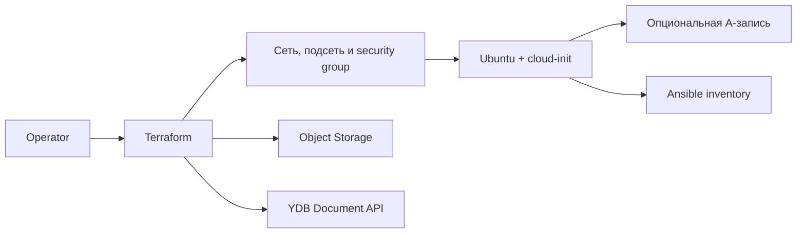

# terraform-yc-infra

[](https://github.com/nikit0id/terraform-yc-infra/actions/workflows/ci.yml)

Terraform описывает небольшую инфраструктуру в Yandex Cloud для [ansible-linux-baseline](https://github.com/nikit0id/ansible-linux-baseline). Каждому окружению соответствует своя сеть, ВМ Ubuntu и ключ состояния.



## Запуск за три команды

Для проверки нужны Terraform 1.9.8, TFLint 0.66 и сеть для получения провайдера. Доступ в Yandex Cloud для прогона тестов не требуется.

```bash
git clone https://github.com/nikit0id/terraform-yc-infra
cd terraform-yc-infra
./scripts/check
```

## Что внутри

- Модули network, vm и dns. SSH ограничен управляющей подсетью, HTTP и HTTPS открыты. cloud-init создаёт оператора ubuntu с вашим публичным ключом.
- В CI выполняются fmt, validate, TFLint и четыре plan через mock_provider. Бот публикует результат в PR своего репозитория. Эти проверки подтверждают структуру конфигурации. Доступность квоты, образа и реальные изменения покажет plan с ключами YC.
- Для подключения backend заранее подготовьте приватный версионируемый бакет Object Storage и таблицу с первичным строковым ключом LockID в YDB с Document API. Дайте сервисному аккаунту доступ к бакету и таблице. Передайте статическую пару ключей через AWS_ACCESS_KEY_ID и AWS_SECRET_ACCESS_KEY, доступ к Compute через YC_TOKEN либо YC_SERVICE_ACCOUNT_KEY_FILE.
- В каталоге выбранного окружения скопируйте backend.example.hcl в backend.hcl и terraform.tfvars.example в terraform.tfvars. Укажите реальные bucket, endpoint YDB, folder, публичный ключ и сеть оператора. Имена ключей state для staging и production различаются.
- Из каталога окружения выполните `terraform init -reconfigure -backend-config=backend.hcl`, затем `terraform plan -out=release.tfplan`. Создание ресурсов платное. `terraform apply release.tfplan` запускает оператор вручную после просмотра. Для завершения испытания оператор проверяет и выполняет destroy своего контура.
- После apply из корня выполните `scripts/inventory staging > ../ansible-linux-baseline/inventories/staging/hosts.local.yml`. Структура baseline и имя пользователя совпадают с playbook.

## Что я узнал

- Разные ключи state разделяют окружения. Блокировка использует таблицу YDB и координирует две записи в один ключ.
- Открытый web-порт и управляющий SSH требуют разных правил ingress. Доступ по SSH задаётся CIDR оператора.
- Публичный адрес надёжнее брать из output после apply. Так замена ВМ попадает в Ansible inventory.

## Что бы сделал дальше

- Проверить захват блокировки двумя операторами на отдельном тестовом бакете.
- Измерить время восстановления ВМ и сравнить результат с ручной настройкой.
